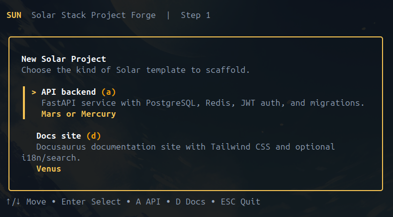

<p align="center">
  <picture>
    <source media="(prefers-color-scheme: dark)" srcset="./assets/sun.png">
    
  </picture>
  <h3 align="center">Sun CLI</h3>
  <p align="center">Ship production-ready backends and docs with one command.</p>
</p>

<p align="center">
  <a href="https://github.com/ayoub3bidi/sun/releases">
    
  </a>
  
</p>

---

## Table of Contents

- [Quick start](#quick-start)
- [Features](#features)
- [How it works](#how-it-works)
- [Templates](#templates)
- [Commands](#commands)
- [Output structure](#output-structure)
- [Development](#development)

---

## Quick start

**Primary — scaffold once, nothing installed (like npx):**

```bash
curl -fsSL https://raw.githubusercontent.com/ayoub3bidi/sun/main/scripts/run.sh | sh
```

**Optional — install `sun` for repeat use:**

```bash
curl -fsSL https://raw.githubusercontent.com/ayoub3bidi/sun/main/scripts/install.sh | sh
sun create
```

**Already have Go installed? One-liner:**

```bash
go install github.com/ayoub3bidi/sun@latest
sun create
```

No Node.js, Python, or Go required on your machine for the first two commands above. See the full [ecosystem map](./docs/SOLAR_STACK.md).

<p align="center">
  
</p>

### Development

```bash
git clone https://github.com/ayoub3bidi/sun
git clone https://github.com/ayoub3bidi/solar-commons

cd sun
go build -o sun .
./sun create
```

Requires Go 1.25.12+ and a sibling `../solar-commons` checkout (`replace` in `go.mod`).

---

## Features

- **Single binary** — no language runtime required on the user's machine
- **Interactive TUI** — Bubble Tea multi-step form with real-time validation
- **Pinned templates** — every scaffold uses a stable semver tag, never `main`
- **Optional features** — toggle OIDC, i18n, search — disabled code is removed entirely
- **Clean git history** — output is a fresh repo with one initial commit, no upstream baggage
- **Manifest-driven** — templates declare their own variables, rewrites, and features in `solar.manifest.yaml`

## How it works

```
┌─────────────┐     ┌──────────────────────────────────────────────────┐
│  sun create │ ──→ │  Bubble Tea TUI: name, version, title, OIDC…     │
└─────────────┘     └──────────────┬───────────────────────────────────┘
                                   ↓
                            ScaffoldConfig
                                   ↓
┌──────────────────────────────────────────────────────────────────────┐
│  solar-commons (Go library)                                          │
│                                                                      │
│  1. Shallow clone template @ pinned ref (v0.1.3, v1.1.1, …)          │
│  2. Strip .git history                                               │
│  3. Parse solar.manifest.yaml                                        │
│  4. Apply variable rewrites (project name, title, version)           │
│  5. Prune disabled features (OIDC paths, i18n, search)               │
│  6. git init + single initial commit                                 │
└──────────────────────────────────────────────────────────────────────┘
                                   ↓
                    ┌──────────────────────────────┐
                    │  ./my-project/               │
                    │  ├── .env.dist               │
                    │  ├── docker-compose.yml      │
                    │  ├── src/                    │
                    │  └── .git/ (clean, 1 commit) │
                    └──────────────────────────────┘
```

The CLI stays thin. All scaffold logic lives in [`solar-commons`](https://github.com/ayoub3bidi/solar-commons). Templates are independent repositories with their own `solar.manifest.yaml` — no template logic is hard-coded in `sun`.

## Templates

| TUI label | Template | Stack | Manifest |
|---|---|---|---|
| API + Alembic (recommended) | **Mars** | FastAPI, Alembic, PostgreSQL, Redis, JWT auth | ✅ `v0.1.3` |
| API + Flyway | **Mercury** | FastAPI, Flyway, PostgreSQL, Redis, JWT auth | ✅ `v0.4.0` |
| Docs site | **Venus** | Docusaurus 3, Tailwind CSS, i18n, search | ✅ `v1.1.1` |

All three templates are wired in the TUI. Pin bumps happen in `registry/registry.go` when template tags move forward.

### Template lifecycle

Each template is a standard public GitHub repository. A `solar.manifest.yaml` at the root declares:

- **`variables`** — what the CLI asks the user (project name, API version, etc.)
- **`rewrites`** — literal string replacements across env files, compose files, source code
- **`features`** — optional components (OIDC, i18n, search) with their removal rules when disabled
- **`default_ref`** — a pinned semver tag for reproducible scaffolds

This means templates evolve independently. A new Mars release only requires bumping `default_ref` — no `sun` release needed.

## Commands

| Command | Description |
|---|---|
| `sun` | Print help and available commands |
| `sun version` | Print the current version, commit, and build date |
| `sun version --check` | Check if a newer version is available |
| `sun create` | Launch the interactive scaffold TUI |
| `sun update` | Update sun to the latest release |

### `sun create` flow

```
Step 1 — Project type
├── API project (Alembic recommended, or Flyway)
└── Docs project

Step 2a — If API
│   ├── Project name, API version prefix, app title
│   └── Include Google OIDC? (default: no)
│   → Output: ./<name>/ (customized Mars or Mercury clone)

Step 2b — If Docs
    ├── Project name, site title
    ├── Include i18n? (default: yes)
    └── Include local search? (default: yes)
    → Output: ./<name>/ (customized Venus clone)
```

### Updating

To update sun to the latest version:

```bash
sun update
```

This downloads the latest release from GitHub and replaces the current binary in-place. If sun was installed via a package manager (Homebrew, Snap, Nix), use that manager to upgrade instead.

You can also check if an update is available without installing it:

```bash
sun version --check
```

#### Automatic update notifications

To receive a notification when a newer version is available, set the `SUN_CHECK_UPDATES` environment variable:

```bash
export SUN_CHECK_UPDATES=1
```

This checks GitHub once per day (in the background) and prints a notice if an update is found.

### Example

```
sun create
  → Project name:       my-api
  → API version prefix: v1
  → App title:          My API
  → OIDC:               No
  → Output:             ./my-api/

cd my-api
cp .env.dist .env
docker compose up
```

## Output structure

A scaffolded API project looks like this:

```
my-api/
├── .env.dist              # renamed, OIDC keys removed
├── docker-compose.yml     # service names renamed
├── Dockerfile
├── alembic/
├── src/
│   ├── main.py            # app title rewritten
│   ├── constants/settings.py
│   ├── routes/
│   ├── controllers/
│   └── utils/
├── .git/                  # single clean commit
├── requirements.txt
└── README.md
```

## Development

### Prerequisites

- Go 1.25.12+
- A sibling checkout of `solar-commons` at `../solar-commons` (the `go.mod` `replace` directive expects this)

### Testing

```bash
go vet ./...
go test ./...
```

### Project layout

```
sun/
├── main.go                # Entry point
├── cmd/
│   ├── root.go            # Cobra root — sun, sun version
│   └── create.go          # sun create — launches TUI
├── registry/
│   └── registry.go        # Template registry (mars, mercury, venus)
├── scripts/
│   ├── run.sh             # Ephemeral npx-style runner (primary)
│   └── install.sh         # Optional persistent install
├── e2e/
│   └── scaffold_test.go   # Integration tests
├── internal/tui/
│   ├── model.go           # Bubble Tea model, steps, scaffold orchestration
│   └── styles.go          # Lipgloss styling
├── .github/
│   ├── workflows/ci.yml
│   └── ISSUE_TEMPLATE/
└── assets/
```
