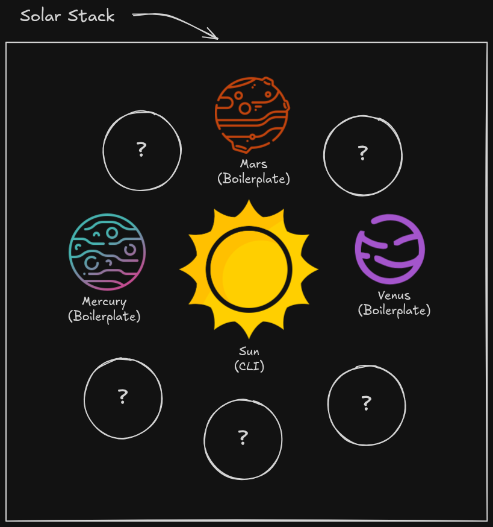

# Solar Stack

The **Solar Stack** is a set of templates and tooling for one-command project scaffolding with the [`sun`](https://github.com/ayoub3bidi/sun) CLI.

<p align="center">
  
</p>

| Repository | Role |
|------------|------|
| [sun](https://github.com/ayoub3bidi/sun) | CLI — interactive scaffold (primary entry point) |
| [solar-commons](https://github.com/ayoub3bidi/solar-commons) | Go engine — clone, rewrite, prune, git init |
| [mars](https://github.com/ayoub3bidi/mars) | API template — FastAPI + Alembic (recommended) |
| [mercury](https://github.com/ayoub3bidi/mercury) | API template — FastAPI + Flyway |
| [venus](https://github.com/ayoub3bidi/venus) | Docs template — Docusaurus + Tailwind |

## Scaffold a new project (no install)

```bash
curl -fsSL https://raw.githubusercontent.com/ayoub3bidi/sun/v1.0.0/scripts/run.sh | sh
```

Optional persistent install:

```bash
curl -fsSL https://raw.githubusercontent.com/ayoub3bidi/sun/v1.0.0/scripts/install.sh | sh
sun create
```
